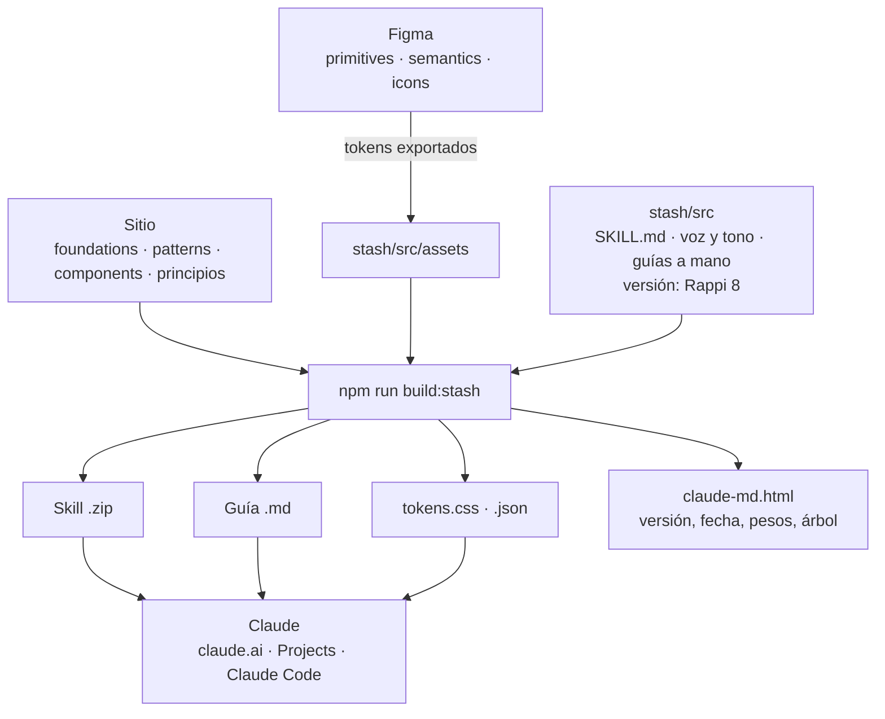

# Mustache — Sitio del Design System de Rappi

**Mustache** es el Design System de Rappi. Este repo es su **sitio de documentación**: explica cómo diseñar y construir con el sistema, y empaqueta ese conocimiento para usarlo con Claude (**Stash**).

La fuente de verdad del sistema vive en **Figma** (librerías `primitives`, `semantics` e `icons`). Este repo documenta y distribuye; no define valores.

- **Producción:** https://mustache-ds.vercel.app _(confirmar dominio canónico)_
- **Versión de la app documentada:** Rappi 8 (ver `stash/stash.config.json`)

---

## Panorama

| Sección | Página | Qué tiene |
|---|---|---|
| Home | `index.html` | Portada: showcase animado, principios, "The signature look" |
| Design | `design.html`, `foundations/`, `design-principles.html` | Cómo funciona Mustache, principios y foundations (color, tipografía, íconos, layout, motion…) |
| Content | `content.html` | Voz y tono, product content, gramática |
| Components | `components.html`, `components/` | Componentes con uso, variantes y tokens |
| Patterns | `patterns.html`, `patterns/` | Patrones de UX (búsqueda, onboarding, diálogos…) |
| AI | — | En construcción (bloqueado en el menú) |
| Brand | `brand.html` | Neon805, PromptMaker e identidad visual |
| **Stash/Resources** | `stash.html`, `claude-md.html`, `resources.html` | **Overview** de la sección · **AI › Claude.MD:** Mustache for Claude (skill, guía y tokens para diseñar con IA) · **Otros recursos:** PromptMaker Neon, Rappi Icon Studio, librerías de Figma y guías |

---

## Correr local

Necesitas Node 18+.

```bash
npm run dev
```

Abre http://localhost:5173. El comando levanta un servidor estático y, mientras corre, regenera el menú de Foundations cuando agregas una página nueva.

Ábrelo siempre por `http://`, no con doble clic (`file://`): los logos y máscaras SVG no cargan bien fuera de un servidor.

### Scripts

| Comando | Qué hace |
|---|---|
| `npm run dev` | Servidor local en el puerto 5173 + menú de Foundations en vivo |
| `npm run build:nav` | Regenera `js/foundations-nav.js` desde los `<title>` de `foundations/` |
| `npm run build:stash` | Regenera el kit de Stash (ver abajo) |

---

## Stash: Mustache for Claude

En el menú aparece como **Stash/Resources**. Su sidebar tiene **Overview** (`stash.html`), la sección **AI** con **Claude.MD** (`claude-md.html`, donde vive el kit) y **Otros recursos** (`resources.html`: PromptMaker Neon y Rappi Icon Studio).

Stash es la sección del sitio donde cualquier persona de Rappi descarga el sistema **listo para Claude**, para que diseñe, prototipe y escriba con nuestras reglas (tokens, no hex; copies que suenan a Rappi).

### Qué se descarga

| Archivo | Para qué |
|---|---|
| `downloads/mustache-ds-skill.zip` | **Skill** para claude.ai o Claude Code. Claude la activa sola y lee solo lo que necesita. |
| `downloads/mustache-ds-guidelines.md` | Todo en un archivo, para el conocimiento de un **Project** |
| `downloads/tokens.css` y `rappi-design-tokens.json` | Tokens `--rp-*` para prototipos en código |

### Cómo se mantiene al día



La misma idea está dibujada en la página, en **Stash/Resources → AI → Claude.MD → Preguntas frecuentes → "¿Cómo se mantiene al día Stash?"**.

1. **Nadie edita `downloads/` a mano.** Todo sale de `npm run build:stash`.
2. El script convierte a Markdown las páginas del sitio (foundations, patterns, components y principios) y las mete en la skill, en `references/site/`, con un índice en `SKILL.md`.
3. Arma el `.zip` y el `.md`, copia los tokens y actualiza en `claude-md.html` la versión, la fecha, los pesos, la cantidad de archivos y el árbol de la skill (todo elemento con `data-stash="…"`).

### Qué editar para cambiar el kit

| Quiero cambiar… | Edito |
|---|---|
| La versión de la app (Rappi 8 → Rappi 9) | `stash/stash.config.json` → `appVersion` |
| Qué páginas del sitio entran | `stash/stash.config.json` → `sections` |
| Reglas, cheat sheet y flujo de la skill | `stash/src/SKILL.md` |
| Guías escritas a mano (color, tipografía, voz y tono, íconos…) | `stash/src/references/` |
| Tokens | `stash/src/assets/` (exportados de Figma) |
| Foundations, patterns, components | Las páginas del sitio, como siempre |

**Regla:** si tu PR toca el sitio o `stash/src/`, corre `npm run build:stash` antes del commit y sube `downloads/` y `claude-md.html` junto con tus cambios. Detalle en [`stash/README.md`](stash/README.md).

**Pendiente:** los tokens todavía se exportan de Figma a mano. El siguiente paso es leerlos con la API de variables de Figma (requiere plan Enterprise) y correr el build en GitHub Actions en cada merge a `main`.

---

## Estructura

```
├── index.html               Home
├── design.html              Cómo funciona Mustache (enlaza a foundations/)
├── design-principles.html   Principios de diseño
├── content.html             Voz y tono, product content
├── components.html          Components · overview (enlaza a components/)
├── patterns.html            Patterns · overview (enlaza a patterns/)
├── brand.html               Neon805, PromptMaker, identidad visual
├── stash.html               Stash/Resources · Overview
├── claude-md.html           Stash/Resources · AI › Claude.MD (Mustache for Claude)
├── resources.html           Stash/Resources · Otros recursos
├── story.html               Historia de Mustache
├── foundations/             Una página por foundation
├── components/              Una página por componente
├── patterns/                Una página por patrón
├── css/
│   ├── tokens.css           Tokens del sitio + escala de títulos (--fs-*) + @font-face
│   ├── site-header.css      Header compartido
│   ├── site-sidebar.css     Sidebar de las páginas de documentación
│   └── hero-particles.css   Fondo de partículas de los hero
├── js/
│   ├── site-header.js       <site-header> (Web Component)
│   ├── site-sidebar.js      <site-sidebar> + scrollspy
│   ├── foundations-nav.js   Menú de Foundations (generado, no editar)
│   ├── hero-particles.js    Partículas de los hero
│   └── pixel-canvas.js      Efecto de las cards del home
├── scripts/
│   ├── dev.js               npm run dev
│   ├── build-foundations-nav.js
│   └── build-stash.js
├── stash/                   Fuentes del kit de Stash (config + src/)
├── downloads/               Kit de Stash generado (no editar a mano)
└── assets/
    ├── isotype-mustache*.svg, mustache-lockup.svg, system-*.svg   Piezas de la marca
    └── identidad-visual/
        ├── fonts/           PP Object Sans (incluida la variable)
        ├── foto/            Fotos, key visuals y videos del home
        ├── logos/           Logos de Rappi y sus productos
        └── foundations/     Covers de las páginas de foundations
```

---

## Convenciones

### Stack

Sitio estático: HTML, CSS y JavaScript sin framework ni paso de compilación. `package.json` solo existe para los scripts de `npm run`; el sitio no tiene dependencias.

**Por qué:** cualquier diseñador puede editar una página con un editor de texto y ver el cambio al recargar.

### Tokens y tipografía

- `css/tokens.css` es la fuente única de los tokens del sitio (`--bg`, `--panel`, `--line`, `--text`, `--muted`…). Cada página lo enlaza; solo agrega en su `:root` lo que es exclusivo de esa página.
- **Habla en tokens, no en hex.** Hex solo si ningún token cubre el caso.
- **Escala de títulos:** usa solo los 6 tamaños de `tokens.css`:

| Token | Uso |
|---|---|
| `--fs-display` | Hero del home |
| `--fs-h1` | Hero de página |
| `--fs-h2-lg` | Secciones de landing (home, brand, stash) |
| `--fs-h2` | Secciones de documentación |
| `--fs-h3` | Cards y bloques destacados |
| `--fs-h3-sm` | Subsecciones y tablas |

- **Fuentes:** PP Object Sans (auto-hospedada, variable) en los títulos del home; Archivo Black (display) e Inter (texto) desde Google Fonts en el resto. IBM Plex Mono (código) solo se carga en el home y en Stash.

### `<site-header>`

Header compartido por todas las páginas menos el home, que tiene su propio menú flotante.

```html
<link rel="stylesheet" href="css/site-header.css">
<script src="js/site-header.js" defer></script>
<site-header active="design"></site-header>
```

- `active` marca la sección actual: `design`, `content`, `components`, `patterns`, `brand` o `stash`.
- Los ítems viven en el array `NAV` de `js/site-header.js`. Stash/Resources va separado del resto por un divisor (blanco al 20%, `mix-blend-mode: plus-lighter`).
- **Si cambias el menú, cambia también el menú flotante de `index.html`** (`.fn-links` y `.fn-menu`).
- Bajo 960px el menú se vuelve un desplegable.

### Marca

El logo se arma con piezas SVG (isotipo + wordmark + descriptor). Las piezas de una tinta usan `fill="currentColor"` o se pintan con `mask`, para recolorearlas desde un solo archivo.

Logos nuevos en `assets/identidad-visual/logos/`, en SVG, con nombres en minúsculas y guiones (`rappi-pay-wordmark.svg`).

### Idiomas

`data-en` / `data-es` + el toggle ES/EN. `data-html` cuando el texto lleva etiquetas. **Hoy solo funciona en el home.**

### Motion

Transiciones y animaciones en CSS. El showcase del home usa animaciones ligadas al scroll (`animation-timeline`), con una versión en JavaScript para Firefox. Todo respeta `prefers-reduced-motion: reduce`.

---

## Deploy

Vercel, proyecto `mustache-ds`. Sin configuración: se sirve la raíz tal cual.

- Merge a `main` → deploy a producción.
- Cada PR → preview deploy.

---

## Contribuir

1. Rama desde `main` → PR → merge.
2. El CSS de una página va en esa página. Lo compartido va en `css/` y `js/`.
3. Habla en tokens y usa la escala de títulos.
4. Si agregas texto al home, pon `data-en` **y** `data-es`.
5. Si tocas el sitio o `stash/src/`, corre `npm run build:stash` antes del commit.
6. Imágenes pesadas: exporta en JPG o WebP al tamaño en que se muestran; videos en MP4 (H.264) sin audio.

---

## Roadmap / deuda técnica

- [ ] Leer los tokens de Stash directo desde Figma y correr `build:stash` en GitHub Actions.
- [ ] Extender PP Object Sans a todo el sitio (hoy solo en los títulos del home).
- [ ] Extender `data-en` / `data-es` más allá del home.
- [ ] Asset de Motion en "The signature look".
- [ ] Optimizar imágenes pesadas del showcase (varias de 1.5–2.7 MB).
- [ ] Sección AI.

---

Interno · Rappi. No open source.
